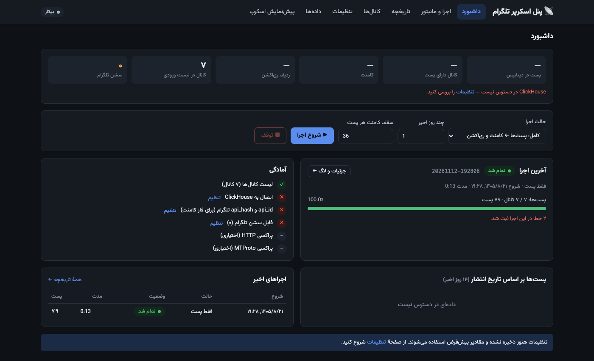
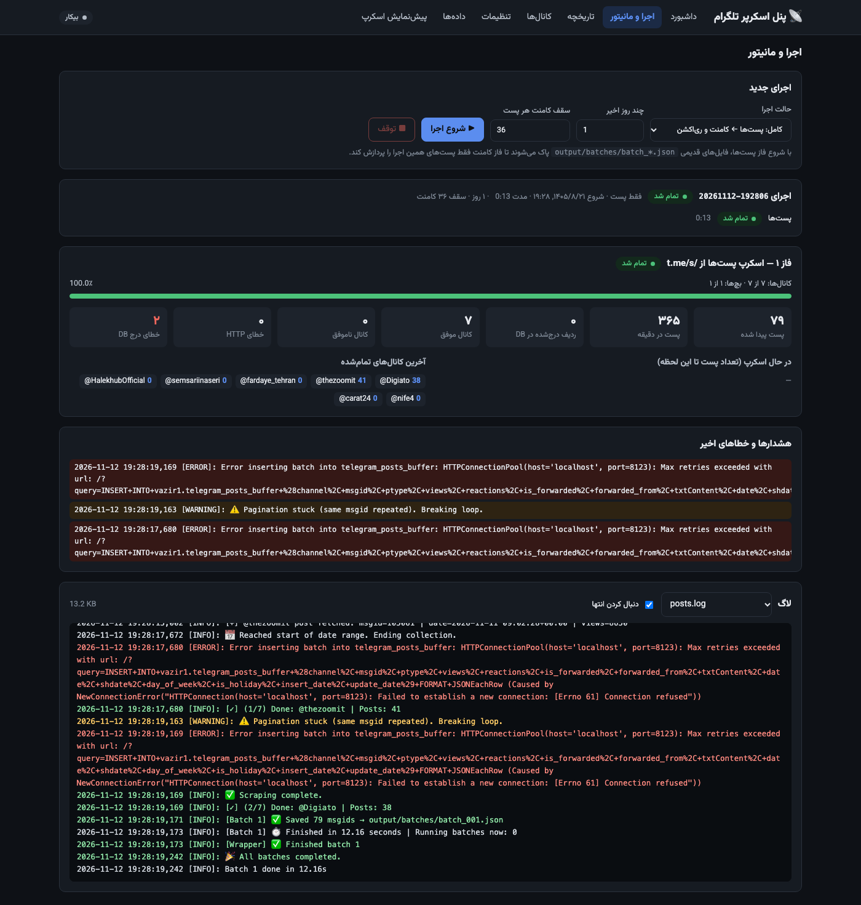
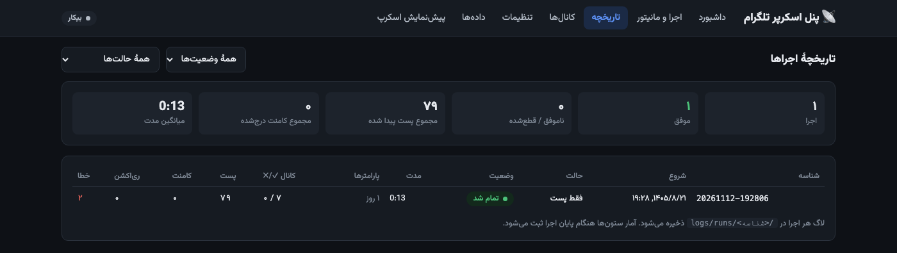
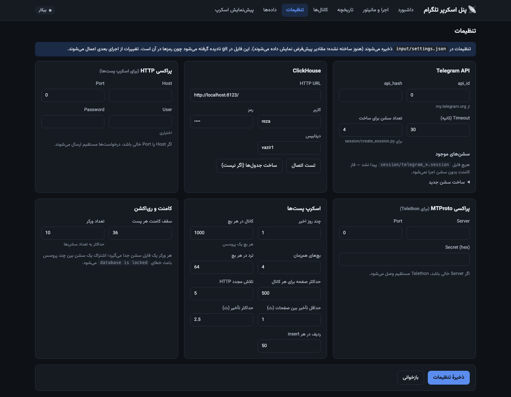
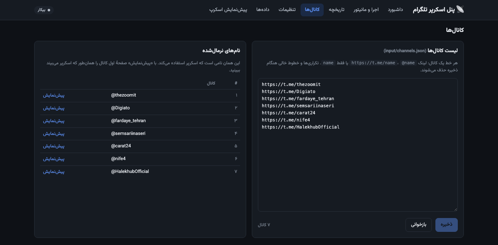
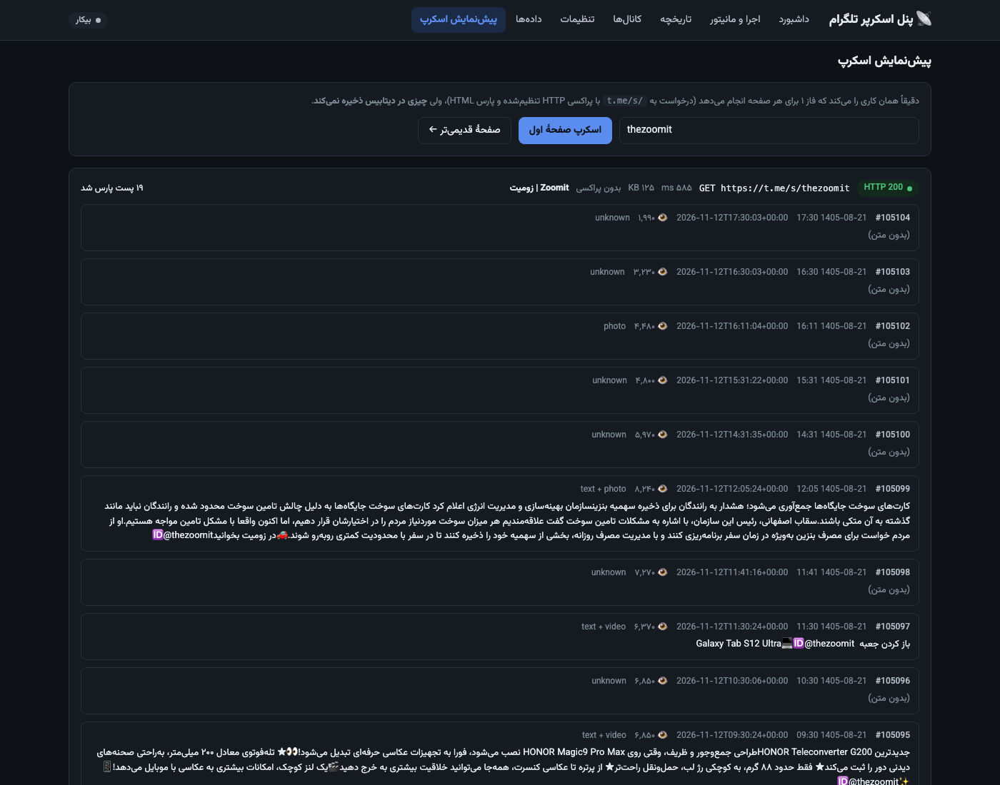

# Daily Telegram Scraper

A modular, high-performance Telegram channel scraper that collects **posts**, **comments**, and **reactions** from public Telegram channels and stores them in **ClickHouse**. It supports HTTP proxy and MTProto proxy connections, Jalali (Shamsi) calendar conversion, parallel batch processing, and distributed tmux-based workers.

---

## Features

- **Post Scraping via HTTP:** Scrapes public channel pages (`t.me/s/{channel}`) using HTTP requests and BeautifulSoup — no Telegram client needed for posts.
- **Comment Fetching via Telethon:** Retrieves threaded comments using the Telegram MTProto API with multiple sessions.
- **Reaction Extraction:** Extracts emoji reactions and their counts for each post.
- **ClickHouse Storage:** All data (posts, comments, reactions) is batch-inserted into ClickHouse using the HTTP interface and Buffer tables for high throughput.
- **Jalali Calendar Support:** Converts Gregorian dates to Jalali (Shamsi), detects Iranian holidays using the `salnama` library.
- **Parallel Batch Processing:** Uses `ProcessPoolExecutor` + `ThreadPoolExecutor` for post scraping across thousands of channels.
- **Distributed tmux Workers:** Launches multiple tmux sessions for concurrent comment/reaction fetching across Telegram sessions.
- **Rate-Limit Handling:** Gracefully handles Telegram's `FloodWaitError` with automatic retry and backoff.
- **Proxy Support:** Supports both HTTP proxies (for web scraping) and MTProto proxies (for Telegram API).
- **Modular Architecture:** Clean separation of concerns across fetch tools, database models, workers, and configuration.
- **Web Control Panel (React):** Configure everything, start/stop runs, watch live progress and logs, browse run history and the scraped data — see below.

---

## Web Control Panel

A React + FastAPI panel for configuring the scraper and watching it work. The UI is in Persian (RTL) and follows the system light/dark theme.

| Page | What it does |
|---|---|
| **Dashboard** | DB totals, readiness checklist (channels, ClickHouse, API keys, sessions, proxies), posts-per-day chart, quick start, recent runs |
| **Run & Monitor** | Start/stop a run (full / posts only / comments only), live progress per phase, channels being scraped right now, per-worker progress & Flood waits, recent warnings/errors, live log viewer |
| **History** | Every past run with status, duration and stats (channels ✓/✗, posts, comments, reactions, errors); click a run to open its details and logs |
| **Channels** | Edit `input/channels.json`, see the normalized names the scraper will use |
| **Settings** | Telegram API, HTTP & MTProto proxies, ClickHouse (connection test + create tables), scraping parameters |
| **Data** | Latest posts and comments, per-channel table, top reactions — straight from ClickHouse |
| **Scrape Preview** | Fetches one `t.me/s/` page exactly like the post scraper does and shows the parsed posts — nothing is written to the DB |

### Screenshots

**Dashboard**



**Run & Monitor** — live progress, issues and log of a run



**History**



**Settings**



**Channels**



**Scrape Preview**



### Run the panel

```bash
pip install -r requirements.txt

# build the React frontend once (Node 18+)
cd frontend && npm install && npm run build && cd ..

# start the panel (from the repository root)
python3 -m web
# → http://localhost:8000
```

| Env var | Default | Description |
|---|---|---|
| `WEB_HOST` | `127.0.0.1` | Bind address (`0.0.0.0` to expose it) |
| `WEB_PORT` | `8000` | Port |
| `WEB_USER` / `WEB_PASSWORD` | `admin` / *(empty)* | Enables HTTP basic auth when `WEB_PASSWORD` is set — **set it before exposing the panel**, it can edit credentials and start processes |
| `SCRAPER_SETTINGS` | `input/settings.json` | Alternative settings file path |

**Frontend development** (hot reload, `/api` is proxied to the panel on `:8000`):

```bash
python3 -m web                     # terminal 1
cd frontend && npm run dev         # terminal 2 → http://localhost:5173
```

### How runs work

- A run started from the panel executes `get_posts.py` and then `get_comments_reactions.py --mode subprocess` as child processes (no tmux needed); **Stop** terminates the whole process group.
- Each run gets a folder `logs/runs/<run-id>/` with `run.json` (status, params, summary), `posts.log`, `comments.log` and `workers/worker_N.log`. The panel derives live progress from these logs, and the History page reads them back.
- Starting the posts phase deletes old `output/batches/batch_*.json`, so the comments phase only processes posts from the current run.
- If the panel restarts while a run is in progress, it re-attaches to the still-running process.

---

## Project Structure

```
daily_telegram/
├── settings.py                        # Settings loader: defaults < env vars < input/settings.json
├── config.py                          # Exposes Telegram/proxy settings (reads settings.py)
├── get_posts.py                       # Main entry point: batch post scraper (multiprocessing + threading)
├── get_comments_reactions.py          # Splits work & launches tmux workers for comments/reactions
├── run_full_scraper.sh                # Shell script to run post scraper then comments/reactions sequentially
├── requirements.txt                   # Python dependencies
├── input/
│   ├── channels.json                  # JSON file with list of Telegram channel URLs
│   └── settings.json                  # Your settings (created by the panel, git-ignored)
├── web/                               # Control panel backend (FastAPI): python3 -m web
│   ├── app.py                         # REST API + serves the built frontend
│   ├── runner.py                      # Starts/stops runs, records them in logs/runs/
│   ├── progress.py                    # Turns run logs into live progress numbers
│   └── clickhouse.py                  # Read-only queries for the dashboard/data pages
├── frontend/                          # Control panel UI (React + Vite)
│   └── src/pages/                     # Dashboard, Run, History, Channels, Settings, Data, Preview
├── docs/screenshots/                  # README screenshots
├── fetch_tools/
│   ├── posts.py                       # HTTP-based post scraper (t.me/s/ pages), parses HTML, inserts to ClickHouse
│   ├── comments.py                    # Async Telethon-based comment fetcher
│   ├── reactions.py                   # Async Telethon-based reaction fetcher
│   ├── utils.py                       # ClickHouse batch insertion, HTML parsing, holiday checking, media type detection
│   └── configDB.py                    # Exposes ClickHouse settings (reads settings.py)
├── db/
│   ├── db.py                          # SQLAlchemy engine & session for ClickHouse
│   └── models.py                      # SQLAlchemy models: BufferPost, BufferComment, BufferReaction
├── utils/
│   ├── worker_posts.py                # Channel normalization, worker function for post fetching
│   └── worker_comments_reactions.py   # Async worker: connects Telethon client, processes batch file
├── session/
│   ├── create_esssion.py              # Script to create multiple Telethon sessions with MTProto proxy
│   └── telegram_*.session             # Auto-generated Telethon session files
├── output/
│   ├── batches/                       # Batch JSON files with channel → msgid mappings
│   └── tmp_batches/                   # Per-worker batch files (worker_batch_N.txt)
└── logs/                              # Log files; panel runs live in logs/runs/<run-id>/
```

---

## How It Works

### Phase 1: Post Scraping (`get_posts.py`)

1. Reads the channel list from `input/channels.json`.
2. Splits channels into batches (default: 1000 channels per batch).
3. Each batch is processed in a separate process (`ProcessPoolExecutor`).
4. Within each batch, channels are scraped concurrently using threads (`ThreadPoolExecutor`).
5. Posts are fetched by scraping `https://t.me/s/{channel}` HTML pages via HTTP (with proxy if configured).
6. Each post is parsed for: message ID, text content, view count, date, and media type.
7. Gregorian dates are converted to Jalali; Iranian holidays are detected.
8. Posts are batch-inserted into the `telegram_posts_buffer` ClickHouse table.
9. Collected message IDs are saved to `output/batches/batch_XXX.json`.

### Phase 2: Comments & Reactions (`get_comments_reactions.py`)

1. Reads all batch JSON files from `output/batches/`.
2. Flattens `(channel, msgid)` pairs and splits them into chunks for N workers.
3. Each chunk is saved as a text file (`worker_batch_N.txt`).
4. tmux sessions are launched, each running `worker_comments_reactions.py` with a Telethon session file.
5. Each worker connects via MTProto proxy, iterates over its batch, and:
   - Fetches reactions per message and inserts into `telegram_reactions_buffer`.
   - Fetches threaded comments and inserts into `telegram_comments_buffer`.

### Full Pipeline (`run_full_scraper.sh`)

Runs Phase 1, waits for completion, then launches Phase 2 — all via tmux with logging.

---

## Setup

### 1. Clone the Repository

```bash
git clone <repository-url>
cd daily_telegram
```

### 2. Install Dependencies

```bash
pip install -r requirements.txt
```

### 3. Configure Telegram, Proxies and ClickHouse

All settings live in **`input/settings.json`** (git-ignored, since it holds credentials). The easiest way to edit them is the **Settings** page of the [web panel](#web-control-panel). You can also write the file by hand. Any key you leave out falls back to the defaults in `settings.py`:

```json
{
  "telegram":      { "api_id": 123456, "api_hash": "your_api_hash", "timeout": 30, "num_sessions": 4 },
  "http_proxy":    { "host": "your_proxy_ip", "port": 8888, "user": "user", "password": "password" },
  "mtproto_proxy": { "server": "your_proxy_ip", "port": 443, "secret": "your_hex_secret" },
  "clickhouse":    { "url": "http://localhost:8123/", "user": "your_user", "password": "your_password", "database": "vazir1" },
  "posts":         { "days": 1, "batch_size": 1000, "max_parallel_batches": 4, "max_threads": 64,
                     "max_pages": 500, "delay_min": 1.0, "delay_max": 2.5, "http_max_retries": 5, "insert_batch_size": 50 },
  "comments":      { "limit": 36, "num_workers": 10 }
}
```

- `api_id` / `api_hash` come from [my.telegram.org](https://my.telegram.org).
- Leave the HTTP proxy `host` empty to scrape directly; leave the MTProto `server` empty to let Telethon connect directly.
- `CLICKHOUSE_HTTP_URL`, `CLICKHOUSE_USER`, `CLICKHOUSE_PASSWORD`, `CLICKHOUSE_DB` environment variables seed the ClickHouse values (values in `settings.json` win).
- `comments.num_workers` is capped at the number of session files: Telethon sessions are SQLite files and cannot be shared by concurrent processes.

### 4. Create ClickHouse Tables

Click **Create tables** on the panel's Settings page, or connect to ClickHouse and create them yourself:

```sql
CREATE DATABASE IF NOT EXISTS vazir1;

-- Main posts table
CREATE TABLE vazir1.telegram_posts (
    channel String,
    msgid UInt32,
    ptype Nullable(String),
    views UInt64,
    reactions UInt64,
    is_forwarded UInt8,
    forwarded_from Nullable(String),
    txtContent Nullable(String),
    date DateTime('Asia/Tehran'),
    shdate String,
    day_of_week UInt8,
    is_holiday UInt8,
    insert_date DateTime('Asia/Tehran'),
    update_date DateTime('Asia/Tehran')
) ENGINE = MergeTree()
ORDER BY (channel, msgid);

-- Buffer table for posts (high-throughput writes)
CREATE TABLE vazir1.telegram_posts_buffer AS vazir1.telegram_posts
ENGINE = Buffer(vazir1, telegram_posts, 16, 10, 600, 10000, 100000, 10000000, 200000000);

-- Main comments table
CREATE TABLE vazir1.telegram_comments (
    comment_id UInt32,
    channel String,
    msgid UInt32,
    user_id UInt64,
    ptype Nullable(String),
    reactions UInt64,
    is_reply UInt8,
    reply_to Nullable(UInt32),
    txtContent Nullable(String),
    date DateTime('Asia/Tehran'),
    shdate String,
    day_of_week UInt8,
    is_holiday UInt8,
    insert_date DateTime('Asia/Tehran'),
    update_date DateTime('Asia/Tehran')
) ENGINE = MergeTree()
ORDER BY (channel, msgid, comment_id);

-- Buffer table for comments
CREATE TABLE vazir1.telegram_comments_buffer AS vazir1.telegram_comments
ENGINE = Buffer(vazir1, telegram_comments, 16, 10, 600, 10000, 100000, 10000000, 200000000);

-- Main reactions table
CREATE TABLE vazir1.telegram_reactions (
    channel String,
    msgid UInt32,
    reaction String,
    count UInt32,
    insert_date DateTime('Asia/Tehran'),
    update_date DateTime('Asia/Tehran')
) ENGINE = MergeTree()
ORDER BY (channel, msgid, reaction);

-- Buffer table for reactions
CREATE TABLE vazir1.telegram_reactions_buffer AS vazir1.telegram_reactions
ENGINE = Buffer(vazir1, telegram_reactions, 16, 10, 600, 10000, 100000, 10000000, 200000000);
```

### 5. Prepare Input Channels

Use the panel's **Channels** page, or edit `input/channels.json`:

```json
{
  "channels": [
    "https://t.me/channel_name_1",
    "https://t.me/channel_name_2"
  ]
}
```

### 6. Create Telegram Sessions

Run the session creator to authenticate your Telegram accounts:

```bash
python3 session/create_esssion.py
```

This will prompt you to enter phone numbers and verification codes for each session.

---

## Usage

The simplest way is the [web panel](#web-control-panel): `python3 -m web`, then **Run & Monitor → Start**. The command-line entry points below still work.

### Run the Full Pipeline

```bash
bash run_full_scraper.sh
```

This will:
1. Scrape posts from all channels (last 1 day by default).
2. Wait for post scraping to complete.
3. Launch tmux workers to fetch comments and reactions.

### Run Post Scraper Only

```bash
python3 get_posts.py --channels input/channels.json --days 3
```

**Arguments:**

| Argument | Default | Description |
|---|---|---|
| `--channels` | `input/channels.json` | Path to the channels JSON file |
| `--days` | `posts.days` (1) | Number of past days to scrape posts for |

### Run Comments & Reactions Scraper Only

```bash
python3 get_comments_reactions.py --limit 36
```

**Arguments:**

| Argument | Default | Description |
|---|---|---|
| `--limit` | `comments.limit` (36) | Maximum number of comments to fetch per post |
| `--mode` | `tmux` | `tmux`: detached tmux sessions. `subprocess`: run workers here, wait, log each to `--log-dir` |
| `--log-dir` | `logs/workers` | Worker log directory (subprocess mode) |

---

## Output Formats

### Post Record (ClickHouse)

```json
{
  "channel": "example_channel",
  "msgid": 12345,
  "ptype": "text + photo",
  "views": 15200,
  "reactions": 42,
  "is_forwarded": 0,
  "forwarded_from": "",
  "txtContent": "Post content text...",
  "date": "2025-06-20 14:30:00",
  "shdate": "1404-3-30",
  "day_of_week": 4,
  "is_holiday": 0
}
```

### Comment Record (ClickHouse)

```json
{
  "comment_id": 78910,
  "channel": "example_channel",
  "msgid": 12345,
  "user_id": 456789123,
  "ptype": "text",
  "reactions": 3,
  "is_reply": 1,
  "reply_to": 78900,
  "txtContent": "This is a reply comment.",
  "date": "2025-06-20 15:00:00",
  "shdate": "1404-3-30",
  "day_of_week": 4,
  "is_holiday": 0
}
```

### Reaction Record (ClickHouse)

```json
{
  "channel": "example_channel",
  "msgid": 12345,
  "reaction": "🔥",
  "count": 15
}
```

---

## Docker

### Build and Run with Docker Compose

```bash
docker compose up -d
```

This starts ClickHouse, the scraper (`app`, runs `run_full_scraper.sh`) and the control panel (`web`) on **http://localhost:8000**. The image builds the React frontend in a Node stage, so you don't need Node on the host. Set `WEB_PASSWORD` in `docker-compose.yml` before exposing port 8000. See `Dockerfile` and `docker-compose.yml` for details.

To run only the database and the panel (and start scrapes from the UI):

```bash
docker compose up -d clickhouse web
```

### Run Interactively (for session creation)

```bash
docker compose run --rm app python3 session/create_esssion.py
```

---

## Configuration Reference

| File | Purpose |
|---|---|
| `input/settings.json` | All settings: Telegram API, proxies, ClickHouse, scraping parameters (edit via the panel) |
| `settings.py` | Defaults, validation and env-var overrides for the above |
| `input/channels.json` | List of Telegram channel URLs to scrape |
| `logs/runs/<run-id>/` | Status, summary and logs of each run started from the panel |

---

## License

This project is licensed under the MIT License. You are free to use, modify, and contribute.

---

## Contributing

Bug reports and feature requests are welcome! Please open an issue or submit a pull request.
